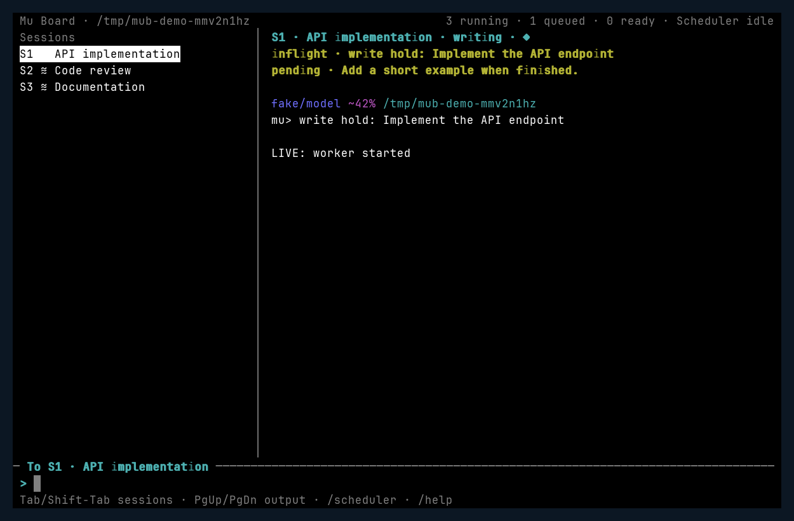
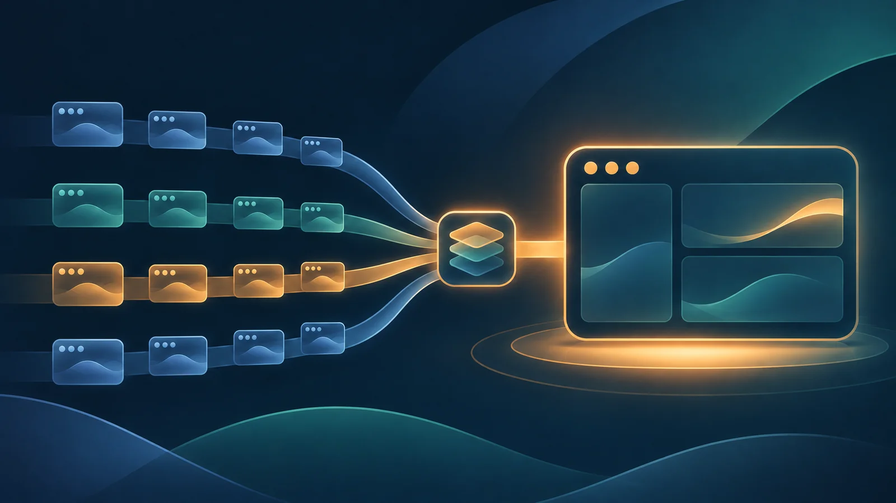

# mub — keep your Mu conversations moving

**A terminal workspace for coordinating [Mu](https://github.com/ylxdzsw/mu)
sessions in one Git checkout.** Queue your next thought while a session is
working, switch between conversations, and let mub coordinate what runs next.


## Make room for more than one conversation

You might be implementing an endpoint in one session, exploring an unfamiliar
module in another, and asking for a review in a third. With mub, you can keep
those conversations separate without juggling multiple terminals or waiting to
send a follow-up.

- **Queue as you go.** Send ordinary messages whenever you think of them; each
  session receives its messages in order, without interrupting its current turn.
- **See the whole board.** Switch sessions in the terminal, follow Mu's live
  output, and keep a separate draft for each conversation.
- **Coordinate shared work.** An AI scheduler considers pending messages and
  the workspace, allowing multiple readers alongside at most one writer.
- **Stay in control.** Inspect scheduler decisions, interrupt a session, or
  explicitly steer a turn when you want to change direction.



*The mub interface in a demonstration worktree using a scripted Mu stand-in.*

## Get started

You'll need **Linux** with pidfd support, **Python 3.12+**, **Git**,
[uv](https://docs.astral.sh/uv/), and [Mu](https://github.com/ylxdzsw/mu)
installed and configured on your `PATH`. Your Mu version must support
`--automated`, `--no-context`, and `mu retry --approve`.

Clone this repository, then install and launch mub:

```sh
git clone https://github.com/ylxdzsw/mub.git
cd mub
uv tool install .
mub -C /path/to/your/git-worktree
```

Or run `./mub -C /path/to/your/git-worktree` directly from the mub checkout;
uv manages its dependencies. For more installation and launch options, see the
[usage reference](docs/usage.md#run).

Type a message and press **Enter** to create your first session. While it works,
you can queue another message, or use **`/new`** to start a separate
conversation. Switch between sessions with **Tab** and **Shift-Tab**; open
**`/scheduler`** to see the scheduler's decisions, and **`/help`** for the full
keyboard reference.

## One workspace, thoughtfully coordinated



Every session is a conversation with its own FIFO queue. The scheduler chooses
which eligible work to run; ordinary messages don't interrupt a running turn.
Readers see the **live checkout**, not isolated snapshots. Multiple readers can
run alongside one writer, while workspace ownership prevents a different writer
from taking over uncommitted changes.

When a writer needs to follow an eligible session with uncommitted work, mub
may ask that session to commit its completed, task-owned changes before the
handoff. Failed or interrupted work can require your explicit attention. Use
`/steer` when you want to redirect a turn rather than queue an ordinary message.

**A few boundaries matter:** Mu's risk traps are not a sandbox; avoid running
another editing agent outside mub against the same checkout. A scheduler
failure holds scheduling until you explicitly use `/schedule`. For details,
including recovery and handoffs, see the [design](docs/design.md) and
[usage reference](docs/usage.md).

## Go further

- [Usage reference](docs/usage.md) — commands, shortcuts, models, recovery, and headless use.
- [Design and scheduling](docs/design.md) — concurrency, handoffs, traps, steering, and persistence.
- [Development](docs/development.md) — code map, build, and tests.
