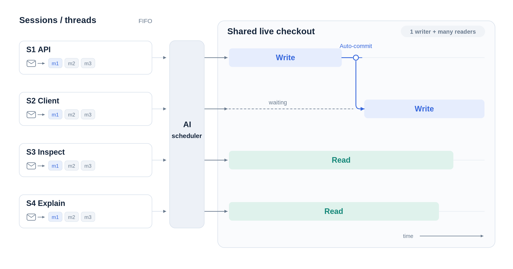

# Design and scheduling

[Home](../README.md) · [Usage](usage.md) · [Development](development.md)

mub coordinates Mu sessions in one live Git checkout. This document describes
the scheduler, its runtime guardrails, and durable state. For day-to-day
commands, see the [usage reference](usage.md).



## Scheduling

A bounded, persistent Mu scheduler wakes on message submissions and worker
exits. It can run alongside workers, but only one scheduler invocation runs at
a time. Events arriving during a scheduler turn are retained for another pass.
Waiting does not poll the model. A fixed 50 ms batching window combines nearby
events without extending the delay on every arrival or skipping scheduling
decisions.

Closing a session only requests reconsideration when messages remain or another
unheld session is blocked, trapped, or authorized to retry. Other pending events
are preserved. With no sessions left, automatic events are consumed without a
scheduler pass; an explicit `/schedule` still requests one.

The scheduler sees pending messages, active workers, Git cleanliness, workspace
ownership, latest worker responses, exit reasons, and complete trap evidence.
It may dispatch several readers and at most one writer, or explain why nothing
should run. Ordinary messages stay in per-session FIFO and never interrupt a
current invocation; the scheduler does not automatically steer them. Explicit
`/steer` redirects are admitted directly by runtime at Mu's safe boundary, without
a scheduler decision.

The scheduler does not return a JSON decision. It reads the current XML snapshot
and uses Bash to issue four small, immediate commands:

```sh
mub run S12 --trap reversible
mub rename S11 "Endpoint implementation"
mub mark-failed S10 "Cannot proceed within the user's authorization"
mub note S13 "Waiting for S10 to implement the endpoint"
mub note S13 --clear
```

`run` selects the runtime's next operation for that session: the oldest pending
message or an eligible continuation. The trap setting also selects workspace
admission:

| Trap | Workspace access |
| --- | --- |
| `reversible` | Reader; reversible and destructive commands are trapped |
| `destructive` | Writer; destructive commands are trapped |
| `off` | Writer; traps are disabled |

`run --approve` approves one pending Bash command on a trapped retry, keeping
the selected trap for later commands. It always requires writer admission for
the whole invocation, including with `--trap reversible`.

The runtime still enforces FIFO, one invocation per session, holds, recovery
authorization, stale-pass protection, and fresh writer admission. `run` never
grants user recovery permission. `rename` changes only an automatic session
name, and `note` is an informational scheduler note, not a dependency,
worker instruction, or execution gate. `mark-failed` records a concrete reason
and leaves the source session awaiting explicit user intervention.

Commands are applied as they are issued and return their immediate admission
result; they do not wait for a worker or poll for completion. A successful
writer handoff reports that the destination is scheduled, not started. The
scheduler finishes once it has made the decisions supported by the snapshot;
the runtime wakes it for later events. It must not sleep, poll status, wait for
an action it initiated, or perform worker work itself. Scheduling mutations go
through `mub`; only necessary readonly inspection is allowed outside it, and
the scheduler must not make any other mutations.

When a selected writer is blocked by an idle, eligible dirty owner, the runtime
automatically asks that source session to commit its completed, task-owned work.
It reserves the destination's specific pending operation, but does not start the
destination yet. After the source completes successfully, the checkout is
probed fresh and the reserved destination starts automatically if it is still
eligible. An unsuccessful handoff is reported on the source; the destination
remains pending and is not marked failed. The runtime does not retry an
unsuccessful handoff without new user input.

A scheduler/provider failure holds scheduling and is not retried. Existing
workers may finish, but their events do not silently release the hold; use the
TUI's `/schedule` to start a fresh scheduler session. After a clean scheduler
pass, mub may display a possible-stall advisory when eligible work remains but
no worker or handoff is making progress. Inspect `/scheduler` to understand
the decision and use `/schedule` explicitly if another pass is wanted. The
advisory does not launch work or rerun the scheduler automatically.

### Scheduler context and usage

Scheduler snapshots are readable XML, not a final JSON action object. They are
organized around sessions rather than a global message list. The snapshot has
global workspace and event sections, then a session section for each board
session. Each session groups its pending FIFO messages, current and previous
run evidence, recent history, waiting note, and runtime-computed eligibility.
The eligibility section identifies the next operation, required reader/writer
admission, recovery and hold gates, and concrete runtime blockers. It describes
what is mechanically possible now; it does not prove that a dependency is
satisfied or that the user's scope authorizes the work.

Worker text is clearly marked as evidence, not scheduler instructions. Omitted
history and fixed journal prefixes remain explicit so contextual approvals and
dependencies can be inspected without pulling later output into an earlier
decision. The scheduler-facing snapshot is separate from durable board state:
internal revision counters and retry byte offsets are not rendered, and nested
messages inherit their session ID. Run IDs, brief diagnostics, and full trap
evidence remain available to correlate events and inspect failures.

Empty optional fields and collections are omitted. Each snapshot fully replaces
earlier state: absence means no value or an empty collection, not unchanged.
Only the explicit history-unchanged marker permits reuse of earlier history.
Boolean false and numeric zero remain explicit.

Compact metadata—IDs, flags, counts, and fixed state labels—is rendered as XML
attributes. Free-form text (including names, commands, diagnostics, and admission
explanations) and nested structures remain child elements. For example:

```xml
<session id="12" name_source="user" held="false" user_continue_authorized="false">
  <name>Fix scheduler wakeups</name>
  <messages>
    <message id="42" delivery_state="pending">
      <text>Check why eligible work is not starting.</text>
    </message>
  </messages>
  <history omitted_turn_count="0" />
</session>
```

| Session section | Meaning |
| --- | --- |
| identity | Board session ID, display title, and automatic/user naming ownership. |
| state and gates | Holds, continuation state, recovery authorization, and runtime detail; a null continuation gate does not imply idle. |
| eligibility | Next pending or continuation operation, access/trap choices, writer ownership, and blockers computed from a fresh runtime view. |
| current/last run | Active or previous operation, access, trap, one-shot approval, completion, diagnostics, and complete trap evidence. |
| history | Recent requests and final responses, with omitted-count and fixed-prefix read commands when a journal exists. |

Run operations include new messages, recovery, worker-mediated handoff commits,
and user redirects. `workspace_access` is `readonly` or `readwrite`;
`command_trap` is `reversible`, `destructive`, or `off`. `approve` records a
single-command exception for that invocation, not a reusable permission. Completion reports Mu
completion separately from Git cleanliness. Redirect phases and recovery gates
remain runtime-owned; a redirect's message remains in the mailbox.

Nested messages contain `id`, verbatim `text`, and `delivery_state`
(`pending`, `inflight`, or `interrupted`); only pending messages are dispatchable.
Workspace fields are `clean`, `git_status` (Git porcelain text), and
`owner_session_id`; an active writer can reserve ownership before making changes.
Trigger events contain `id`, `kind`, `session_id`, and event-specific fields such
as `message_id`, `outcome`, `detail`, `superseded_message_id`, or `run_id`.

Worker responses come from canonical Mu journal text, not PTY progress notices or
screen redraws. Snapshots include each session's recent materialized requests and
final responses before any active invocation. Requests and responses are
excerpted with explicit omission markers and a count of older turns, while
pending/inflight messages and trap evidence remain complete. Failure
diagnostics are kept separately from assistant responses. Unsuccessful runs include
a bounded `terminal_tail` exported from the terminal emulator after PTY capture
finishes, rather than raw redraw sequences. It may include wrapped text or earlier
turns and is not a complete transcript; runtime errors and full trapped-command
evidence remain separate. The scheduler view
shows the XML snapshot, command feedback, and any stall advisory; blocked
sessions, holds, and failures still surface reasons requiring attention.

Within one scheduler session, unchanged conversational evidence may be
referenced rather than resent. This only describes reused history, not unchanged
session state. Each pass still receives current gates, holds, ownership, active
workers, FIFO mailboxes, and eligibility. The latest XML snapshot overrides
older state; earlier command explanations are not policy. A fresh scheduler session
receives the full runtime/workflow introduction, I/O contract, scheduling policy,
and typical examples. All pending events are merged into one scheduling pass;
events arriving during that pass are collected for the next one. Subsequent
wakeups list the batch of events **since the previous snapshot**, not since the
previous pass ended, followed by the current snapshot. These events are not a
to-do list: the scheduler may already have observed or addressed some through
command feedback, or runtime may have handled them. It reconciles the current
snapshot with prior command results and acts only where a decision is still needed.

Only clean scheduler sessions rotate: after 12 passes, at 32,000 context tokens
(or half the model's context window, whichever is smaller), after compaction,
or when scheduling policy changes. These are between-pass thresholds, not hard
limits on a large message or tool result. A fresh session receives policy and all
current context excerpts again. Older Mu journals are never changed or deleted;
their IDs remain in `scheduler.previous_sessions`. Failed or interrupted turns
still require explicit `/schedule` recovery, never automatic retry.

History references point to a fixed journal byte prefix, so inspection cannot
pull later worker output into an earlier decision. Use the read-only command:

```sh
mub context S1                           # exact requests and final responses
mub context S1 --requests                # inspect scope and restrictions only
mub context S1 --before 12345 --turn t3   # one turn from a snapshot's prefix
```

The scheduler must retrieve missing context before interpreting contextual
approvals or dependencies, and inspect omitted user requests before authorizing
writes or relaxing traps. Excerpts never imply that earlier restrictions expired.
These checks remain model instructions, not a sandbox or a new approval system.

The TUI may show recent scheduler usage, including provider requests, reported
input/cached-input/output/reasoning tokens, compactions, and elapsed time.
Missing usage is unreported, not zero cost; journals retain detailed provider
records.

Scheduler creation and every scheduler invocation use Mu's `--no-context`,
omitting skills and global/project `AGENTS.md` while retaining the system preamble,
runtime, tools, and configuration. Passing it on every invocation also keeps
automatic compaction's new system prompt lean. Workers retain normal context,
including retries and commit handoffs. This requires a Mu version supporting
`--no-context`.

Existing schedulers are not rotated just to apply this option: their persisted
system prompt remains until compaction or the normal rotation rules take effect.

### Session names and dependencies

Sessions created without a name start as `Session N`. During scheduling passes,
the scheduler is instructed to give every auto-owned default title a short
topic-based name as soon as queued messages or conversation reveal a topic,
even if the initial prompt is blocked. It can rename and set a waiting note or
take another eligible action for the same session in the same pass, including
alongside the first dispatch. With no topic yet, it leaves the default.
It updates automatic names when the conversation's main focus changes, not every
turn. It should aim for titles within
40 characters as a soft limit, not a hard ceiling. Names do not include execution
status; session IDs remain stable. Explicitly supplied names are user-owned and
never overwritten by the scheduler. `/rename --auto` keeps the current title
until a later scheduling pass finds a useful replacement; renaming alone does
not wake the scheduler or affect queued work or holds. Existing sessions saved
before name ownership was introduced keep their names as user-owned; use
`/rename --auto` to opt them in.

The scheduler reasons about prerequisites from messages and outcomes; there is
no dependency graph, numeric priority system, task decomposition, or PM review.
A clean exit means the turn returned—not that mub verified its implementation.

### Readers and the writer

- Multiple readonly workers may run alongside one readwrite worker.
- A session can have only one invocation at a time.
- Readers observe the **live checkout**, not an isolated snapshot. The scheduler
  can defer reads that need a stable baseline.
- A new writer requires a clean checkout, or must be the session that already
  owns its dirty changes.
- An idle, trapped, failed, or held session retains ownership while its changes
  remain uncommitted. Independent readers may still run.
- Existing changes without a known owner block writer dispatch. Resolve them
  manually, then use `/schedule` to recheck.

Git checks include staged, unstaged, and non-ignored untracked files. mub never
automatically stashes, resets, switches branches, rolls back, pushes, or accepts
abandoned changes as another worker's baseline.

### Traps and handoffs

Readonly workers use `--trap reversible`. These are Mu's **model-declared risk
traps, not a sandbox**. A trapped reader may be promoted to writer only when the
writer slot and workspace ownership permit it.

The scheduler resolves ordinary task-related traps automatically, without
requiring `/resume`. Its initial readonly classification is provisional, not a
user prohibition on writes. It interprets conversational change requests in
context. Discussion or inspection scope prohibits implementation changes, not
necessary reversible inspection setup: opening an isolated browser's Edit view
to inspect controls can be approved without authorizing implementation. The
scheduler judges actual effects rather than treating a risk label or button name
as a scope conflict. Writer promotion and trap relaxation do not change the
worker's original user scope. Actual out-of-scope changes, effects on unrelated
or shared user data, and operations needing broader permission remain blocked
with a concrete explanation.

A session waiting for a writer slot, workspace access, a prerequisite, or more
scheduling evidence keeps its pending work and continuation state. This includes
trapped turns waiting for admission and sessions whose prerequisites are held or
failed. The scheduler explains the blocker to the user with `mub note` and ends
its pass; the runtime wakes it on relevant events. Harmless task-scoped reversible
setup, such as browser testing during a review, does not require failure or user
intervention just because readonly admission trapped it. Continue with an appropriate
trap setting when admitted, or leave the turn trapped and pending with a waiting note.

`mark-failed` stops this session's work when concrete evidence shows that it needs
user intervention: a worker reports a fatal task error, a trapped command would
violate user scope or perform an unauthorized destructive action, or the worker
establishes an unrecoverable condition with no authorized way to proceed. The
reason identifies the failure and its evidence. A trap alone is insufficient;
ordinary task-scoped traps can continue with suitable access when admitted.
Runtime already gates Mu startup failures, crashes, and nonzero error exits as
failed, except that exit code 3 denotes a trap and user-stopped runs are
interrupted. The scheduler preserves existing recovery gates. Ordinary tool
errors and failing tests remain part of ongoing work when the worker can address
them within scope.

Explicit continuation permission is required after failure and interruption;
user holds always prohibit execution. Resuming a trapped turn preserves its trap
classification and full command evidence for the scheduler, separately from
explicit continuation permission.

Normal dispatch and retry policies pair readonly access with `--trap reversible`,
readwrite access with `--trap destructive`, or readwrite access with traps off
only when unrestricted permission is justified. Trap policy applies to the
**rest of that turn**. A subsequent normal turn gets a fresh access/trap policy.

For an isolated authorized exception, the scheduler can use
`mub run S12 --trap reversible --approve` (one reversible setup command) or
`mub run S12 --trap destructive --approve` (one authorized destructive command).
Mu approves only the first pending Bash command; later commands still obey the
selected trap. Approval does not bypass command validation or repeat started
higher-risk commands. mub requires an eligible trapped retry with full command
evidence and reserves writer access for the entire invocation, even with
`--trap reversible`. Approval survives a successful reserved handoff, but expires
with its invocation and is never automatically renewed after failure or interruption.
Recovery must obtain fresh trap evidence before another one-shot approval.

The scheduler chooses between one-shot approval and lifting the trap based on
the expected workflow. Repeated legitimate reversible operations, such as browser
testing for a nominally readonly review, should normally use `--trap destructive`
rather than approve every command. It need not wait for repeated traps when the
workflow is already clear. Repeated destructive work justifies `--trap off` only
when the user's scope supports it; repetition itself grants no permission.
After `/resume`, the scheduler makes this choice using the command evidence and
user authorization. `/resume` permits recovery, not unrelated or out-of-scope work;
there is no separate TUI approval command.

Before a dirty handoff, when there is no explicit steering request, the scheduler
prefers the owner's oldest ordinary FIFO message when it directly continues the
uncommitted work and both naturally fit in one coherent commit. Relatedness is
inferred from messages and worker outcomes, not code review.
This soft preference can outweigh global submission order, but not explicit user
priorities or prerequisites. It is reassessed after each turn: the scheduler does
not skip messages, drain unrelated work, indefinitely delay other writers, or wait
for a possible future follow-up. Holds, recovery gates, and writer ownership still
apply, and independent readers may still run. This avoids commit boundaries solely
for session switching without requiring the worker to combine commits.

When the scheduler selects a writer that needs a dirty checkout, the runtime
handles the handoff automatically. It asks the idle, eligible dirty owner to
commit only its completed, task-owned changes or explain why it cannot. The
source handoff is recorded before the destination starts: the destination's
specific operation is scheduled, but the destination has not started. After a
successful worker-mediated commit, a fresh Git probe admits that reserved
destination if it is still eligible. This is not an implementation follow-up or
permission to commit incomplete or unrelated work.

If the source refuses, traps, fails, is interrupted, or returns with a dirty
checkout, the handoff is unsuccessful on the source session. The destination
remains pending and is not marked failed. mub does not retry the handoff without
new user input.

The scheduler does not investigate implementation quality, repair failures,
troubleshoot provider issues, or work around Mu bugs. Worker-turn failures are
exposed and may block dependent messages; failed Mu turns are not automatically
retried.

### Interruption and shutdown

Interrupting a session records a user hold before signaling its processes. The
hold blocks all automatic work, including queued messages, retries, and handoffs.
Selecting a session, scrolling, or changing models does not release it.

A new ordinary message releases the user hold for scheduling, but **does not
authorize retrying an interrupted turn**. `mu retry` continues the old turn and
cannot accept changed instructions. Use `/resume` explicitly after inspecting it;
ordinary messages remain queued behind the interrupted work. To replace that
unfinished work instead, use `/steer <text>`. For inactive interrupted, trapped,
or failed sessions, the UI asks for confirmation. The TUI's `/steer` command is
itself authorization; holds and recovery gates still apply.

Steering an active turn is soft: the current provider request and running Bash
calls finish before the old turn stops, with no further old-turn work. Mu must
have `soft_interrupt` enabled (the default); mub checks that its signal handler
is installed before sending SIGQUIT to Mu alone, never its Bash children. A running
write may finish before the redirect takes effect; steering does not undo it.
Runtime admits the redirect at Mu's safe boundary without a scheduler decision,
starting its replacement invocation only after the old one stops. It inherits the
prior access mode (or readonly if none),
but gets a fresh normal trap: reversible for readonly, destructive for readwrite;
it never inherits traps off. Writer-slot and dirty-owner restrictions still
apply. Direct admission works while the scheduler is held if no promotion or
dirty handoff is needed; those still require scheduler authorization. Old pending
tool calls are superseded, not retried, the redirect is kept in Mu history, and
task success is not implied. Steering has no timeout or escalation; use
`/interrupt` to stop and hold it. Mu cannot accept a new prompt during unfinished
compaction or while existing input has not been materialized. mub keeps the
redirect pending; inspect and use `/resume` to explicitly recover the blocking
turn before steering continues. That recovery requires a scheduler-authorized
Mu retry and may continue old work before the redirect is delivered. Uncertain
delivery and crashes require explicit recovery, never silent retry or discard.
If the targeted invocation finishes naturally before steering takes effect, the
explicit redirect still gets delivered, without interrupting a successor.

Quitting with active workers or a scheduler asks for confirmation, defaulting to
Cancel. Confirmation stops every owned invocation and records interruptions
before exiting. Workers are not left detached. Reopening does not silently
restart user-interrupted sessions.

There are no mub execution deadlines, inactivity watchdogs, or retry cooldowns;
Mu owns execution timeouts. Explicit stopping uses SIGINT, followed by SIGKILL
for remaining owned processes after a short shutdown grace period. A second
interrupt forces termination immediately.

## Persistence

**`.mu/mub.json` is the only mub-owned durable state file.** It contains session
references, mailboxes, steering records, in-flight invocation records, holds and
outcomes, workspace ownership, pending scheduling events, and model choices. It is atomically replaced
and locally Git-ignored via Git's `info/exclude` without editing tracked ignore
configuration.

Mu journals own delivered conversations. mub does not copy transcripts or archive
terminal logs. Live output and full trap evidence are transient; history replays
from Mu. Only bounded recent outcome excerpts are kept for scheduling, alongside
current blocked and failure reasons. The latest scheduler application results and
per-session scheduling annotations are also kept in the board snapshot for display.
A stable owner lock and a live control socket are runtime artifacts in `.mu/`.

A journal offset records each delivery boundary, allowing mub to distinguish a
completed message from an invocation that never accepted its input. A crash
leaves uncertain in-flight work held for explicit inspection and continuation;
messages are not blindly resubmitted. Live processes from a previous
owner prevent a replacement owner from starting. Removing a session only detaches
it from mub; it never deletes the Mu journal or undoes edits.

Exiting with all worker sessions removed retires the active scheduler session and
clears pending scheduling events, provided no queued/in-flight work or workspace
ownership remains. The next board starts with fresh scheduler context, without
the previous reason, error, pass count, or context hashes. Model preferences,
identifier counters, usage history, and archived scheduler IDs are retained;
Mu journals are untouched. Merely having no running workers does not reset a
board that still has sessions open.

Old task-board snapshots are **not automatically converted**. Opening one fails
without overwriting it. Archive the old `.mu/mub.json` explicitly before starting
a new board; Mu journals remain untouched.
